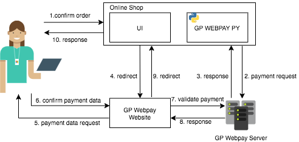

# gpwebpay_demoshop

Demo webshop showing how to integrate [gpwebpay](https://github.com/filias/gpwebpay) with Flask and React.js.



## Setup

You need Python 3.10+, [uv](https://docs.astral.sh/uv/), and npm installed.

### Environment variables

Set the variables required by the gpwebpay package. See the [gpwebpay docs](https://github.com/filias/gpwebpay) for details.

```
GPWEBPAY_MERCHANT_ID=...
GPWEBPAY_MERCHANT_PRIVATE_KEY=...          # base64-encoded PEM
GPWEBPAY_PUBLIC_KEY=...                     # base64-encoded x509 certificate
GPWEBPAY_MERCHANT_PRIVATE_KEY_PASSPHRASE=...  # optional
GPWEBPAY_CALLBACK_URL=https://localhost:5000/payment_callback
```

### Backend

```bash
uv sync
uv run python app.py
```

### Frontend

```bash
cd app
npm i
npm start
```

Open [http://localhost:3000](http://localhost:3000) to view it in the browser.

## License

MIT
